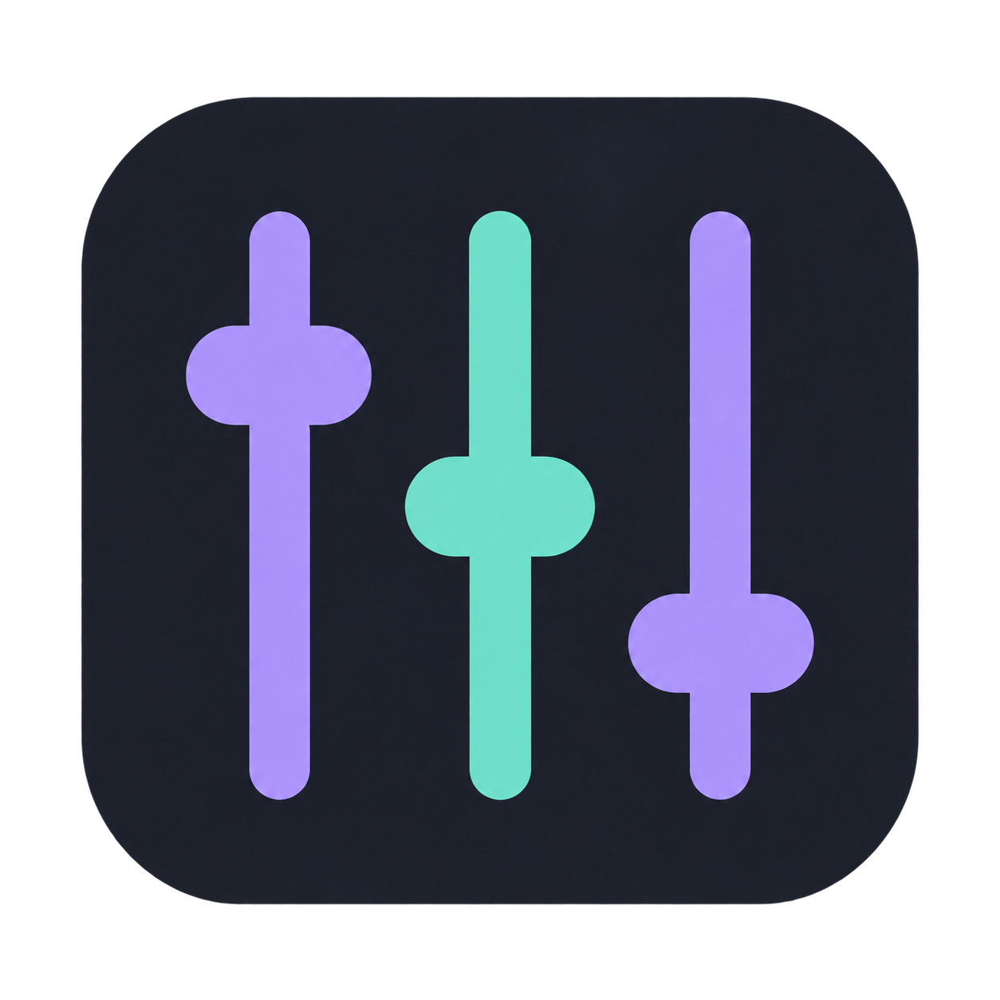

<p align="center">
  
</p>
<h1 align="center">Portable Audio Mixer</h1>
<p align="center"><strong>Mix your audio. Shape your sound.</strong></p>
<p align="center">
  
  
  
  <a href="LICENSE"></a>
</p>
<p align="center">
  <a href="https://github.com/minjae9010/portable-audio-mixer/raw/refs/heads/main/downloads/PortableMixer.exe"></a>
</p>
<p align="center">
  <a href="README.md">English</a> · <a href="README.ko.md">한국어</a> · <a href="README.ja.md">日本語</a> · <a href="README.zh-CN.md">简体中文</a>
</p>

---

## Your app audio and microphone, together

Mix your selected apps with your microphone and send the result to Discord through **VB-CABLE**. App faders and mute affect only the outgoing mix; they never change Windows app volume. Listen to the same final mix through your default speakers and optionally save it as WAV.

| Mix | Control | Listen |
|:---|:---|:---|
| Multiple apps + microphone | Independent outgoing app gains | Hear the final mix through default speakers |
| Optional WAV recording | Separate input gains | Start and stop listening independently |

> [!IMPORTANT]
> The bundled VB-CABLE installer requires your consent and administrator access. Real VB-CABLE activation, WASAPI output, and Discord reception have **not yet been verified on the test PC**. See [validation](#validation) before relying on this workflow.

## Quick start

1. **[Download PortableMixer.exe](https://github.com/minjae9010/portable-audio-mixer/raw/refs/heads/main/downloads/PortableMixer.exe)**, run it on Windows 11 x64, and approve the UAC prompt.
2. If VB-CABLE is missing, select `예` (Yes) to open the bundled official installer, then choose **Install Driver**. After the installer closes, the app disables the device and exits. Reboot if the manufacturer requests it, then launch the app again.
3. Add apps with `앱 추가` (Add App), then click **`믹스 시작` (Start Mix) on the main screen**. A microphone is optional and starts disabled. Add one or enable WAV recording through `송출 설정` (Output Settings). If startup is blocked, check the device status on the main screen.
4. In Discord, select **CABLE Output (VB-Audio Virtual Cable)** as the input device.
5. Close the app with **X** or **Exit** to disable the VB-CABLE device. The next launch enables it again.

The EXE includes the complete official Pack45 package and its original readme; no separate ZIP download or runtime network connection is needed. Declining installation lets you continue using the volume mixer. Use `VB-CABLE 설치 / 안내` (VB-CABLE Installation / Guide) to try again later. The app UI currently uses Korean labels.

### Audio path

```text
App audio + microphone
          │
     Portable Mixer ──────► WAV file (optional)
          │
      CABLE Input         playback side
          │
      CABLE Output        recording side
          │
        Discord
```

Output uses WASAPI shared mode at **48 kHz / stereo / PCM16**. Keep your usual speakers or headphones as the Windows default output. Main-screen app faders and mute change only each captured contribution to the mix, preserving the original Windows session settings. Apps can be added or removed while mixing; closed inputs become silent and reconnect after the same app restarts. Other apps sending directly to CABLE can also be heard at its capture endpoint.

## Hear your current audio

Turn on **`믹스 듣기` (Listen to Mix)** to send the exact final mix block to the Windows default speakers as well as the virtual microphone. App gains, mute, microphone gain, and the output master all apply. No capture-device selection is needed. You can enable it before starting the mix; turning it off only stops speaker monitoring.

If the Windows default output is the same virtual-cable endpoint, monitoring is blocked. Choose physical speakers as the Windows default and toggle listening off and on. Speaker failure does not stop virtual-microphone output. Original app playback may overlap the monitored mix when both use the same speakers. This monitors local audio before Discord processing.

## Device lifecycle

| Action | What happens |
|:---|:---|
| Launch the app | Enables the standard VB-CABLE device |
| Stop the mix | Stops audio; keeps the device enabled |
| Minimize / hide to tray | Keeps the app and device active |
| Close with X / Exit | Stops audio and disables the device |
| Main app crashes | A separate watcher attempts to disable the device |

<details>
<summary><strong>Device behavior and recovery details</strong></summary>

- Disabling operates on the Windows PnP device, including playback and recording endpoints. It is more than muting audio.
- The driver package stays installed. Disabled entries can remain in Device Manager or Windows settings, and Discord may take time to refresh its list.
- If both the app and its watcher are killed, or power is lost, cleanup cannot run. Relaunch and exit the app, or disable the device manually in Device Manager.
- Only one standard VB-CABLE is supported. CABLE A/B/C/D, Voicemeeter, and other devices are not controlled. Multiple matching devices cause startup to stop.
- Other programs sharing this VB-CABLE also lose access when this app disables it.

</details>

## Validation

These are recorded project results, not new hardware tests performed for this documentation update.

| Check | Recorded result |
|:---|:---|
| Windows app build | Passed |
| Mixer / WAV / PCM core tests | Passed |
| Device lifecycle simulations | 9 scenarios passed |
| Bundled package integrity | 31 files matched original sizes and SHA256 hashes |
| Official Pack45 Windows 10/11 x64 catalog | Microsoft signature verified |
| Bundled installer execution on the test PC | **Not tested** |
| Actual device activation / deactivation, WASAPI output, Discord reception | **Not verified** |

[Hardware validation procedure (Korean)](docs/VIRTUAL_CABLE.ko.md) · [Download checksums](downloads/SHA256SUMS.txt)

## Build

Use Visual Studio 2022 C++ Build Tools, Windows SDK, and CMake. Run from the repository root in Developer PowerShell:

```powershell
.\scripts\build-windows.ps1
```

The current app build does not require the WDK. The build checks the original `downloads/VBCABLE_Driver_Pack45.zip` using SHA256 and embeds it as a resource. Distribute the EXE.

## Documentation and licensing

- [Detailed Korean guide](README.ko.md)
- [VB-CABLE verification procedure (Korean)](docs/VIRTUAL_CABLE.ko.md)
- [Release notes (Korean)](docs/EXE_RELEASE.ko.md)

App source is licensed under [MIT](LICENSE). **VB-CABLE is a separate VB-Audio Donationware product**, excluded from this project's MIT license. See the manufacturer's [licensing and distribution terms](https://vb-audio.com/Services/licensing.htm) and [donation / license purchase page](https://shop.vb-audio.com/en/win-apps/11-vb-cable.html).

<details>
<summary>Legacy driver experiments</summary>

`driver/` and `downloads/driver/` preserve the earlier 0.3 custom-driver experiment and unsigned packages. **The current app does not use them; do not install them.** Older WAV prototype documents and UI validation records describe their respective historical versions.

</details>
